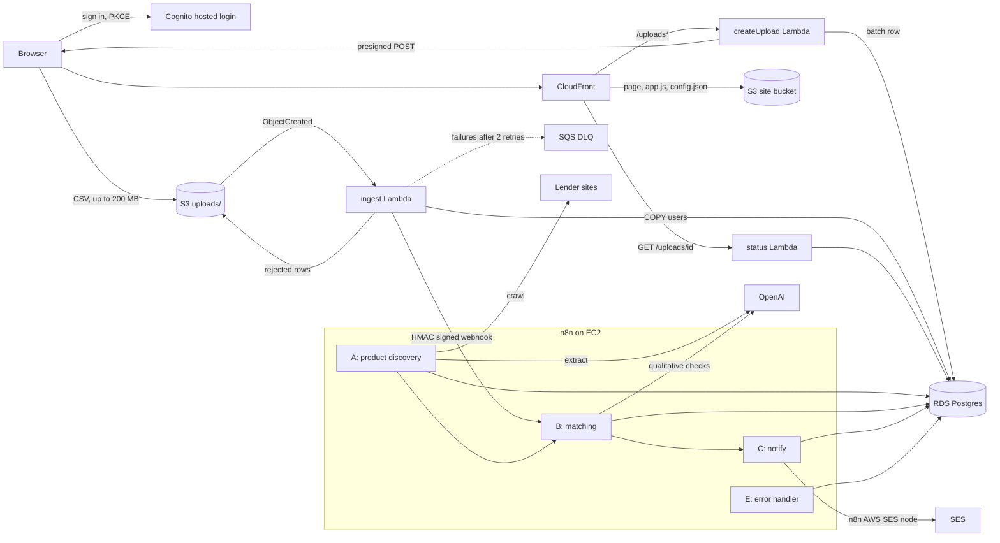

# Loan Eligibility Engine

Upload a CSV of users, match every user to personal loans read live from lender websites, and email each user their best offers.

- **Access**: staff sign in through a Cognito user pool; API Gateway rejects upload and status calls without a valid token.
- **Ingestion**: the browser uploads straight to S3 with a presigned POST; an S3 event starts a streaming ingest Lambda.
- **Discovery** (n8n workflow A): crawls lender pages daily and extracts structured products with an LLM.
- **Matching** (n8n workflow B): a SQL hard filter, then LLM checks on qualitative criteria for groups of similar users, cached across batches.
- **Notification** (n8n workflow C): sends HTML emails through SES.
- **Errors** (n8n workflow E): any workflow failure is recorded, the batch is marked failed, and the admin is emailed.

## Architecture



The page is static files in a private S3 bucket behind CloudFront, so loading it never waits on a Lambda. CloudFront forwards `/uploads*` to API Gateway on the same origin, so there is no CORS between the page and the API. All Lambdas run in private subnets with no NAT. They reach S3 through a gateway endpoint, and n8n through its private IP. The n8n host has no inbound public ports: its webhook accepts traffic from the Lambda security group only, and the editor opens over an SSM port forward.

## The matching funnel

Checking every user against every product with an LLM does not scale. Each stage passes on only what it cannot settle:

1. **SQL hard filter.** Income, credit score, age and employment type are checked against each product in a single set-based query. It also computes a fit score and a plain-language reason.
2. **Profile classes.** The surviving pairs are grouped by employment type plus bands of income (₹25k), credit score (50) and age (5 years). Users in the same class get the same answer on qualitative criteria, so the LLM sees classes, not users.
3. **Verdict cache.** Verdicts are cached by product version and class, so later batches reuse them. When the crawler sees a product's criteria change, it bumps the version, so stale verdicts are never read.
4. **LLM judge.** Only uncached classes reach the model: 20 classes per call, a strict JSON schema, temperature 0. Failed calls are retried individually, up to 4 rounds.

Measured locally with 6 live products:

| Batch | Pairs | After SQL | Classes | Cache hits | LLM calls | Matches | Matching time |
|---|---:|---:|---:|---:|---:|---:|---:|
| 10k users, cold cache | 60,000 | 15,606 | 787 | 0 | 42 | 15,606 | 77 s |
| Same 10k, warm cache | 60,000 | 15,606 | 787 | 787 | 0 | 15,606 | 0.9 s |
| 1M users | 6,000,000 | 1,844,818 | 4,515 | 787 | 189 | 1,838,607 | 240 s |

Ingesting 1M rows (100 MB) takes 54 s locally. The ingest Lambda has 15 minutes.

## Design decisions

- **Presigned POST, not an API upload.** API Gateway caps payloads at 10 MB and requests at 30 s. The browser sends the file to S3, and the policy enforces the size limit (`content-length-range`).
- **Streaming ingest.** The Lambda reads the S3 body line by line and loads valid rows with `COPY`, so memory stays flat at any file size. Bad rows go to `errors/<batch>.csv`, which the UI offers as a download.
- **Idempotent ingest.** S3 can deliver an event twice. A batch that is already ingested only re-triggers matching. Re-uploading a byte-identical file (same ETag) marks the new batch `duplicate` and points to the original.
- **Signed webhooks.** The ingest Lambda signs the payload with HMAC-SHA256. Workflow B verifies the raw body before doing any work.
- **Crawler change detection.** Pages are cleaned and fingerprinted. An unchanged page skips the LLM, and a failed source keeps its last known products.
- **Extraction is audited, and its rules are enforced in code.** Every extracted field was checked by hand against the lender pages. Three errors were found, which wrongly excluded 5,477 user–lender pairs. Rewording the prompt did not fix them reliably, so the validation step enforces the rules. See [docs/extraction-accuracy.md](docs/extraction-accuracy.md).
- **Demo email limit.** Only the `DEMO_LIMIT` best-matched users are emailed; the rest are recorded as `suppressed`. Every address is rewritten to `GMAIL_BASE+<name>@gmail.com`, so no real user is emailed.
- **Staff-only access.** Uploads spend OpenAI credits and send email, so every `/uploads` route has a Cognito JWT authorizer on API Gateway. Requests without a valid token never reach a Lambda. Accounts are created by an admin (self sign-up is off), and each batch records who uploaded it. The page uses the authorization code flow with PKCE, so no client secret ships to the browser. Running locally there is no sign-in: the local API binds to 127.0.0.1 only.
- **No NAT gateway.** n8n is the only component that needs the internet, so it runs in the public subnet. Everything else stays private.

## Repository layout

```
backend/src/loan_engine/   Lambda code: ingest, batches, reports, handlers/
backend/tests/             unit tests, including golden tests for workflow B's SQL
db/migrations/             schema and crawl sources, applied in order
n8n/workflows/             workflows A, B, C and E, imported on n8n start
n8n/bootstrap.sh           imports credentials from env, imports and publishes workflows
ui/                        upload and tracking page, served from S3 through CloudFront
infra/n8n-host.sh          starts n8n on the EC2 host, secrets from SSM
scripts/                   local API, local ingest, deploy, tunnels, load generator
serverless.yml             Lambdas, HTTP API, VPC, RDS, S3, EC2, IAM
```

## Run locally

Requires Docker, [uv](https://docs.astral.sh/uv/) and Python 3.12.

```sh
cp .env.example .env              # set OPENAI_API_KEY, secrets, GMAIL_BASE
make up                           # Postgres, migrations, n8n on :5678
make api                          # UI and API on http://localhost:8040
```

Open http://localhost:8040 and drop a CSV. Other entry points:

```sh
make ingest FILE=data/users.csv                       # ingest without the UI
python scripts/gen_users.py data/users-1m.csv 1000000  # load test file
make test lint
```

The local API stands in for API Gateway, S3 and the Lambdas, and runs the same ingest code. Without SES keys, sends are recorded as `failed` and the rest of the pipeline still completes.

## Deploy to AWS

Requirements:
- AWS credentials allowed to create the resources in `serverless.yml`.
- The Session Manager plugin for the AWS CLI.
- A Serverless account (`npx serverless@4 login`).

1. Verify the sender address and the recipient inbox in SES (ap-south-1). While SES is in the sandbox, every recipient must be verified: verify `GMAIL_BASE@gmail.com`, since `+` aliases deliver to it.
2. Put the production secrets in `.env.aws` (same keys as `.env.example`), then store them in SSM:
   ```sh
   make params STAGE=dev
   ```
3. Deploy:
   ```sh
   make deploy STAGE=dev
   ```
   This builds the Lambda bundle and deploys the stack, runs the migrations, then ships `n8n/` to the EC2 host and starts it.
4. Create an access key for the stack's SES user (output `SesSenderUser`) and add it to `.env.aws`. Then run `make params` and `make deploy` again.
5. Invite staff. Cognito emails each person a temporary password:
   ```sh
   aws cognito-idp admin-create-user --user-pool-id <StaffPoolId output> \
     --username person@company.com --user-attributes Name=email,Value=person@company.com Name=email_verified,Value=true
   ```
6. Optional custom domain: request an ACM certificate for the name in `us-east-1` (CloudFront only reads certificates from there), validate it through DNS, then set `domain` and `certificateArn` for the stage under `params` in `serverless.yml` and deploy again. The stack adds the domain to CloudFront, the Cognito callback URLs and the S3 CORS origins. Finally, point a CNAME for the name at the `SiteDomainName` output.
7. Open the UI at the CloudFront URL printed by the deploy. To reach the n8n editor, run `make n8n-tunnel` and open http://localhost:5679. For psql, run `make db-tunnel`, which listens on `localhost:55433`.

Secrets never reach git or the CloudFormation template:
- RDS reads its password through an `ssm-secure` dynamic reference.
- The Lambdas receive the database password and webhook secret, resolved from SSM at deploy time.
- The n8n host builds its `.env` from SSM at start.

## Credentials in n8n

The workflows reference three n8n credentials by fixed ID. They are never stored in git or in the workflow JSON.

| Credential | Type | Used by | Values |
|---|---|---|---|
| Loan Engine Postgres (`loanEnginePg001`) | Postgres | A, B, C, E | `DB_HOST`, `DB_PORT`, `DB_NAME`, `DB_USER`, `DB_PASSWORD`, `DB_SSL` |
| Loan Engine OpenAI (`loanEngineAi001`) | OpenAI | A, B | `OPENAI_API_KEY` |
| Loan Engine SES (`loanEngineSes01`) | AWS | C and E, through the AWS SES node | `AWS_REGION`, `SES_ACCESS_KEY_ID`, `SES_SECRET_ACCESS_KEY` |

**Automatic.** On every start, `n8n/bootstrap.sh` runs `n8n/credentials.js`, which builds the three credentials from the container environment and imports them with `n8n import:credentials`. It then imports and publishes the workflows. Locally the environment comes from `.env`. On AWS, `infra/n8n-host.sh` writes it from SSM Parameter Store (`/loan-engine/<stage>/*`). n8n encrypts stored credentials with `N8N_ENCRYPTION_KEY`, which also comes from SSM.

**By hand**, for an n8n you run yourself. Open the editor (`make n8n-tunnel` on AWS) and go to Credentials → Add credential:
1. **Postgres**: host is the RDS endpoint, database and user are `loan_engine`, port is 5432, and SSL is `require`. Name it `Loan Engine Postgres`.
2. **OpenAI**: paste the API key. Name it `Loan Engine OpenAI`.
3. **AWS**: set the region to `ap-south-1` and use the access key of the SES sender user. That IAM user may only call `ses:SendEmail` on identities and configuration sets in this account. Name it `Loan Engine SES`.

Then open each workflow and pick the matching credential on every Postgres, OpenAI and AWS SES node. Bootstrapped credentials keep the fixed IDs, so imported workflows need no changes.

Notes:
- If the SES identity has a default configuration set, the sender policy must allow `configuration-set/*`, or every send fails with `AccessDenied`.
- The n8n connection to RDS is encrypted, but n8n does not verify the RDS certificate. The Lambdas do verify it, against the bundled RDS CA. The database is reachable only from the Lambda and n8n security groups.
